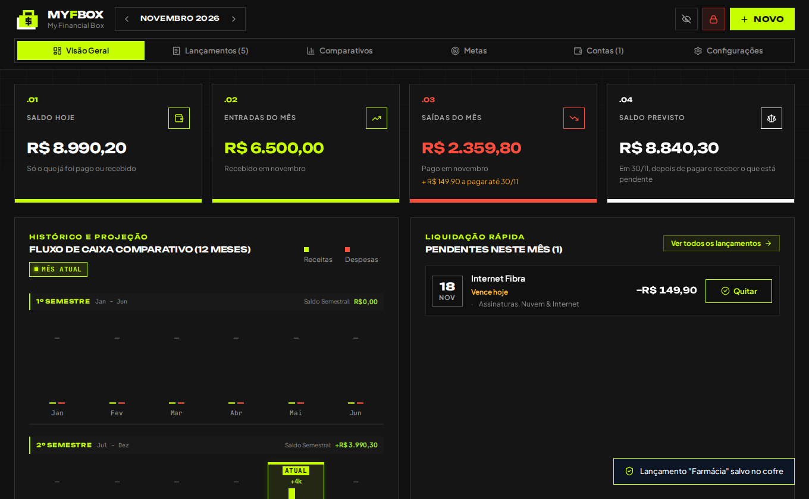
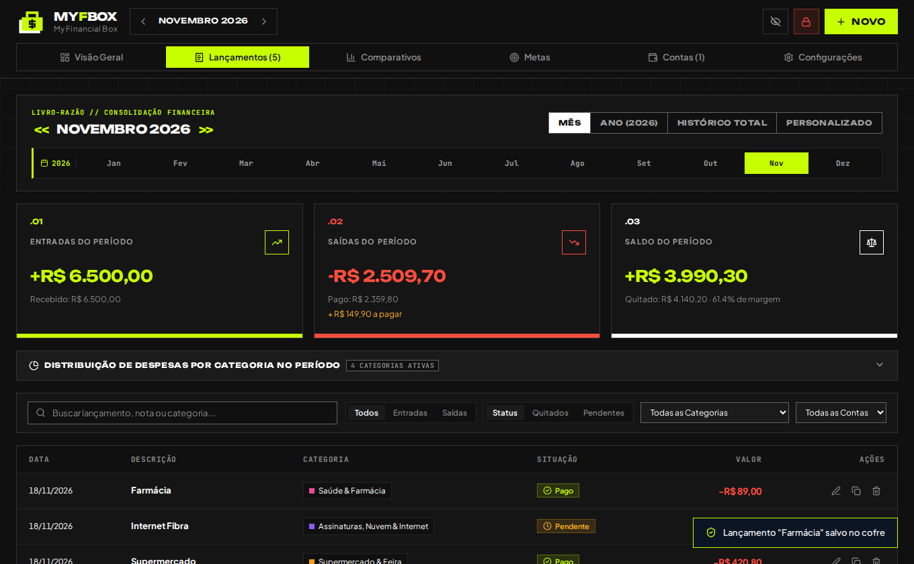
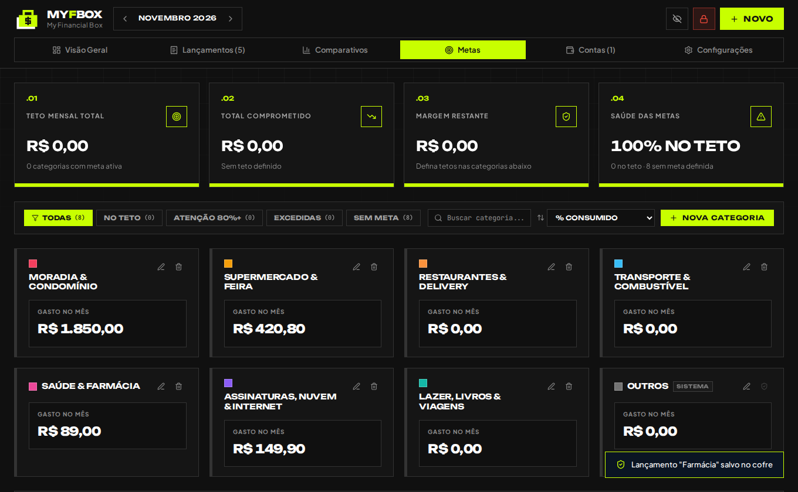

🇧🇷 [Português (Brasil)](README.md) · 🇬🇧 [English (UK)](README.en-GB.md) · 🇪🇸 [Español](README.es.md) · 🇨🇳 [简体中文](README.zh-CN.md)

# MyFBox

**Your personal finances under your control — 100% free, open-source, and encrypted on your device.**

[](https://github.com/thiegocarvalho/MyFBox/actions/workflows/ci.yml)
[](https://github.com/thiegocarvalho/MyFBox/actions/workflows/desktop-release.yml)
[](https://github.com/thiegocarvalho/MyFBox/actions/workflows/gh-pages.yml)
[](https://github.com/thiegocarvalho/MyFBox/releases)
[](LICENSE)
[](docs/i18n/SECURITY.en-GB.md)
[](#local-mcp-mode)

**[Open in Browser](https://thiegocarvalho.github.io/MyFBox/app/)** · **[Download Desktop App (Win / Mac / Linux)](https://github.com/thiegocarvalho/MyFBox/releases)** · **[Official Website](https://thiegocarvalho.github.io/MyFBox/)**

No subscription, no account registration, no cloud server, and no tracking: all your financial data is stored solely on your computer or browser, encrypted with **AES-256-GCM**. Only your master password unlocks the vault.

---

## Download or use now

Choose how you prefer to use MyFBox — both formats are **free**, work offline, and use the same encrypted backup format (`.myfbox.json`):

| Platform | Format | Where to access |
|---|---|---|
| **Web (Browser / PWA)** | Chrome, Edge, Firefox, Brave, Safari | **[Open in Browser](https://thiegocarvalho.github.io/MyFBox/app/)** |
| **Windows** | `.exe` installer (NSIS) and portable version | **[GitHub Releases](https://github.com/thiegocarvalho/MyFBox/releases)** |
| **macOS** | `.dmg` image (Apple Silicon `arm64` and Intel `x64`) | **[GitHub Releases](https://github.com/thiegocarvalho/MyFBox/releases)** |
| **Linux** | `AppImage` and `.deb` package | **[GitHub Releases](https://github.com/thiegocarvalho/MyFBox/releases)** |

> Desktop installers are built automatically by the [Desktop Release](.github/workflows/desktop-release.yml) workflow on each new tag published in [Releases](https://github.com/thiegocarvalho/MyFBox/releases) (see also [thiegocarvalho.github.io/MyFBox/#baixar](https://thiegocarvalho.github.io/MyFBox/#baixar)).

---

## Why use MyFBox?

| | Typical cloud apps | **MyFBox** |
|---|---|---|
| **Price** | Monthly plans or paywalled features | **100% free and open-source (`AGPL-3.0`)** |
| **Account & sign-up** | Require email, password, and terms acceptance | **Zero sign-up — open and use in seconds** |
| **Where your data lives** | Third-party servers | **Only on your device (AES-256-GCM)** |
| **Works without internet** | Depends on a server | **100% offline** |
| **AI assistant** | Your statements are uploaded to the cloud | **Local MCP on `127.0.0.1` only when the vault is unlocked** |

---

## Screenshots

| Overview | Transactions | Budgets |
|---|---|---|
|  |  |  |

---

## Talk to your finances (Local MCP)

MyFBox lets you connect **Claude Desktop, Claude Code, Cursor, Antigravity**, or any **MCP (Model Context Protocol)**-compatible client directly to your unlocked vault, without ever sending your password or master key outside your computer:

> *"Log £84.50 for groceries today on Monzo"* · *"How much have I spent on groceries this month?"* · *"Remember that the £149.90 internet bill is due on the 25th"*

- **Off by default:** you enable it in Settings whenever you want to use it and authorise pairing via visual code verification.
- **Locked, disconnected:** locking the app (manually or through inactivity) terminates the connection immediately.
- **Ready on Desktop and Web:** the **Desktop app** has the MCP server built in; on the **Web version**, simply copy the ready-to-use prompt or `mcp.json` under **Settings → AI Assistant (MCP)** (runs via `npx` without cloning the repository).
- **20 ready-to-use tools:** transactions, queries, budgets, accounts, offline exchange rates, monthly insights, and encrypted backup (see [how to configure](#local-mcp-mode)).

---

## Key features

- **Encrypted vault (AES-256-GCM)**: accounts, transactions, categories, budgets, and insights live in a single encrypted vault. The key is derived from your master password via `PBKDF2-HMAC-SHA256` (600,000 iterations) and never leaves memory.
- **Full-featured transactions**: instalments, monthly recurrence, paid/pending status, smart automatic categorisation by description, and ultra-fast entry (<kbd>N</kbd> shortcut).
- **Multi-currency (100% offline)**: accounts and transactions in 13 global currencies (BRL, USD, EUR, GBP, and more), with exchange rates managed locally without calling external APIs.
- **Overview and forecast**: today's balance (confirmed), monthly income/expenses, overdue pending items, and projected end-of-month balance.
- **Comparisons and insights**: track month-over-month progress with analyses generated on demand by your assistant via MCP.
- **Monthly budgets**: set spending caps per category and monitor usage in real time.
- **Portable backups and CSV**: export your encrypted vault (`.myfbox.json`) to store wherever you like, or generate CSV spreadsheets.

---

## Keyboard and Productivity

MyFBox is designed for logging expenses and income in seconds without taking your hands off the keyboard:

### Global Shortcuts
| Shortcut | Action |
|---|---|
| <kbd>N</kbd> | Opens the **New Transaction** modal (when no text field is focused) |

### Inside the Transaction Modal
| Shortcut | Action |
|---|---|
| <kbd>Ctrl</kbd> + <kbd>Enter</kbd> or <kbd>⌘</kbd> + <kbd>Enter</kbd> | **Save to Vault** / Save changes |
| <kbd>Ctrl</kbd> + <kbd>Shift</kbd> + <kbd>Enter</kbd> or <kbd>Alt</kbd> + <kbd>N</kbd> | **Save & New** (saves the current transaction and clears the form for the next one without closing the modal) |
| <kbd>Alt</kbd> + <kbd>1</kbd> or <kbd>Alt</kbd> + <kbd>D</kbd> or <kbd>Ctrl</kbd> + <kbd>↓</kbd> | Switch to **Expense** (Debit) |
| <kbd>Alt</kbd> + <kbd>2</kbd> or <kbd>Alt</kbd> + <kbd>R</kbd> or <kbd>Ctrl</kbd> + <kbd>↑</kbd> | Switch to **Income** (Credit) |
| <kbd>Esc</kbd> | Cancel and close the modal |

### Quick Entry Flow
1. Press <kbd>N</kbd> on any screen to open the transaction modal with **immediate focus on the amount**.
2. Type the amount (e.g. `150.50` or `2400`) and press <kbd>Tab</kbd>.
3. Type the description (e.g. `Supermarket`); **smart prediction** automatically selects the category.
4. Press <kbd>Ctrl</kbd> + <kbd>Enter</kbd> to save, or <kbd>Ctrl</kbd> + <kbd>Shift</kbd> + <kbd>Enter</kbd> to start the next transaction right away.

---

## Your data and backups

- In the **Web** version, data exists only in the browser and origin in use (clearing site data or switching browsers hides the local vault). In the **Desktop** app, the vault is saved at `vault.myfbox.json` inside the system data directory (`app.getPath('userData')`).
- Export backups under **Settings → Backups & Files → Download encrypted backup**. The `.myfbox.json` file is already encrypted and can be stored in the cloud or on a USB drive; it opens with the master password that was active at the time of the backup.
- **There is no password recovery.** Store your master password in a password manager.
- The app requests **persistent storage** from the browser to prevent automatic eviction due to low disk space.

### Encrypted file format

The envelope uses `formatVersion: 1`, with `PBKDF2-HMAC-SHA256` (600,000 iterations) and `AES-256-GCM` parameters recorded in the header.

---

## Local MCP mode

Allows MCP-compatible AI assistants to read and log transactions **while the vault is open and unlocked**:

1. Open MyFBox (Desktop or Web), unlock the vault, and go to **Settings → AI Assistant (MCP)**.
2. Turn on the **Local MCP mode** toggle.
3. Copy the **ready-to-use prompt** (or `mcp.json`) shown on screen and send it to your AI assistant.
4. Open the pairing link returned by the assistant, verify the short code, and click **Authorise**.

Tool details and usage workflows:
- [`.claude/skills/myfbox/SKILL.md`](.claude/skills/myfbox/SKILL.md): tools and transactions
- [`.claude/skills/myfbox-insights/SKILL.md`](.claude/skills/myfbox-insights/SKILL.md): monthly insights

Optional server environment variables: `MYFBOX_APP_URL` (default `http://localhost:41730`), `MYFBOX_MCP_PORT` (default `4777`), `MYFBOX_BACKUP_DIR` (default `vaults/`).

---

## For developers (running from source)

### Requirements
- Node.js `^20.19` or `>=22.12`
- Modern browser (Chrome, Edge, Firefox, Brave, or Safari)

### Installation and local run

```bash
git clone https://github.com/thiegocarvalho/MyFBox.git
cd MyFBox
npm install
npm run dev
```

Open **http://localhost:41730**, create a vault, and set a master password.

> **The port is fixed on purpose.** The web vault lives in IndexedDB, isolated by origin. If opened on another port, the vault will appear empty (it remains saved under the previous origin). That is why Vite uses `strictPort`.

| Command | What it does |
|---|---|
| `npm run dev` | Development server on `127.0.0.1:41730` |
| `npm run build` | Type-check + production build in `dist/` (with Content Security Policy) |
| `npm run preview` | Serves the production build on the same port |
| `npm run lint` | Lint with oxlint |
| `npm test` | Unit tests (Vitest) |
| `npm run test:coverage` | Unit tests with coverage report (v8) |
| `npm run test:e2e` | End-to-end tests (Playwright) against `vite preview` |
| `npm run mcp` | Starts the local MCP server manually |
| `npm run electron:dev` | Opens MyFBox in Electron in development mode |
| `npm run electron:start` | Compiles app + Electron and opens the desktop window |
| `npm run dist:linux` | Builds Linux packages (`AppImage` and `deb`) in `release/` |
| `npm run dist:win` | Builds Windows installer (`nsis` and `portable`) |
| `npm run dist:mac` | Builds macOS image (`dmg` `x64` and `arm64`) |

### Structure

```text
src/
  App.tsx                     state owner; every write goes through persistVaultUpdate
  domain/                     pure vault use cases, schema validation, and cryptographic IDs
  components/                 views (Overview, Transactions, Comparisons, Budgets, Accounts, Settings)
  services/cryptoVault.ts     encrypts/decrypts the vault with WebCrypto (AES-256-GCM + PBKDF2)
  services/vaultStorage.ts    persistence adapter (desktop IPC or IndexedDB in the browser)
  services/currencyService.ts offline catalogue and conversion for 13 currencies
  services/mcpBridge.ts       browser bridge to the local MCP server
  services/mcpActions.ts      MCP actions (20 pure tools)
  utils/                      calculations, formatting, categorisation, and MCP config
electron/                     secure desktop shell (`main.ts`, `preload.ts`, `vaultStore.ts`, `menu.ts`)
landing/                      static landing page for GitHub Pages root (excluded from Electron)
e2e/                          end-to-end tests with Playwright
mcp/server.mjs                MCP server (stdio) + authenticated WebSocket/HTTP bridge on 127.0.0.1
```

## Security and Contributing

- Security and threat model: [SECURITY.en-GB.md](docs/i18n/SECURITY.en-GB.md)
- How to contribute: [CONTRIBUTING.en-GB.md](docs/i18n/CONTRIBUTING.en-GB.md), [CODE_OF_CONDUCT.en-GB.md](docs/i18n/CODE_OF_CONDUCT.en-GB.md), and [CLAUDE.md](CLAUDE.md)

## Licence

Copyright (C) 2026 Zeru.

This programme is free software: you can redistribute it and/or modify it under the terms of the **GNU Affero General Public License**, version 3 or (at your option) any later version, as published by the Free Software Foundation. See the [LICENSE](LICENSE) file.

In short: you may use, study, modify, and distribute MyFBox. If you distribute a modified version **or make it available for others to use over a network** (for instance, by hosting the app), you must make the source code of that version available under the same licence.
