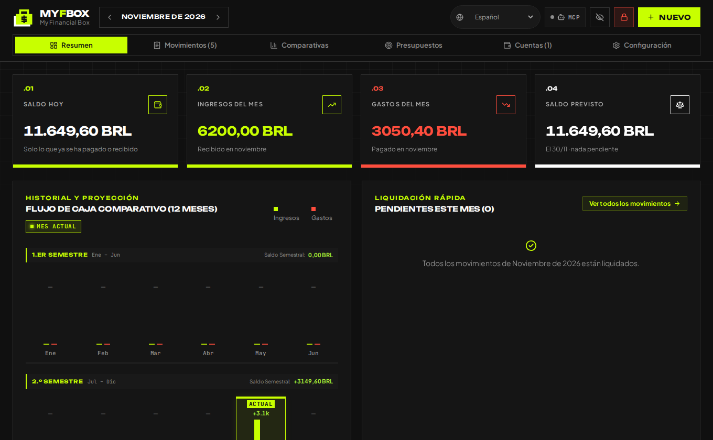
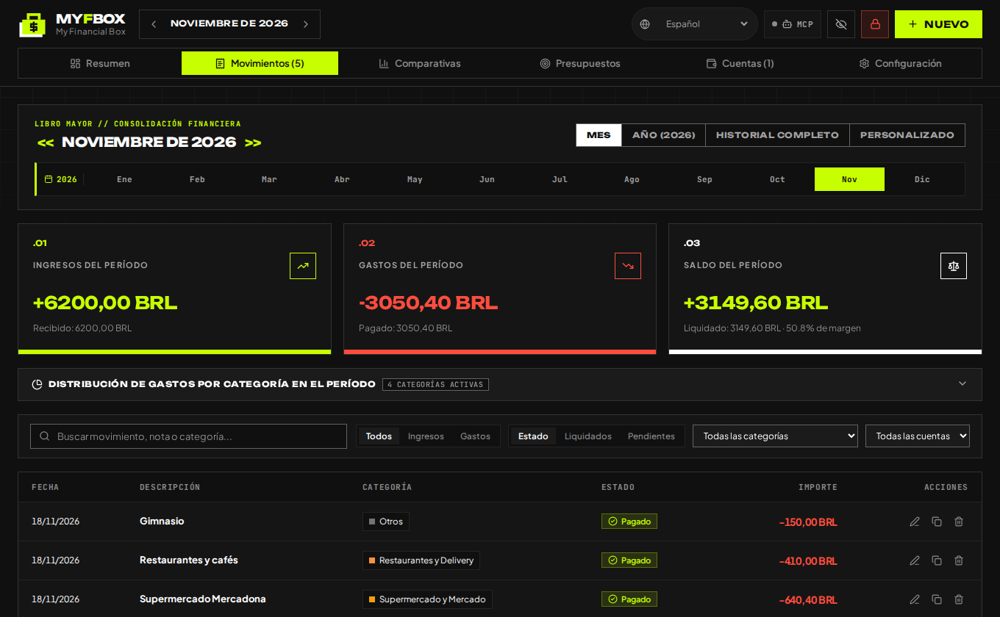
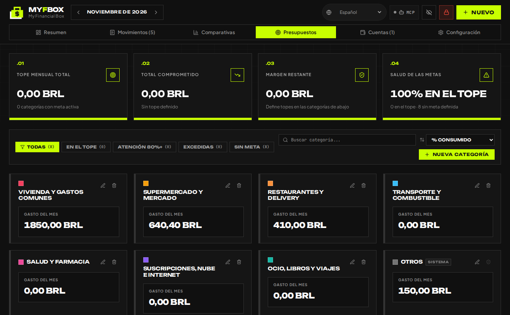

🇧🇷 [Português (Brasil)](README.md) · 🇬🇧 [English (UK)](README.en-GB.md) · 🇪🇸 [Español](README.es.md) · 🇨🇳 [简体中文](README.zh-CN.md)

# MyFBox

**Tus finanzas personales bajo tu control — 100% gratuito, de código abierto y cifrado en tu dispositivo.**

[](https://github.com/thiegocarvalho/MyFBox/actions/workflows/ci.yml)
[](https://github.com/thiegocarvalho/MyFBox/actions/workflows/desktop-release.yml)
[](https://github.com/thiegocarvalho/MyFBox/actions/workflows/gh-pages.yml)
[](https://github.com/thiegocarvalho/MyFBox/releases)
[](LICENSE)
[](docs/i18n/SECURITY.es.md)
[](#modo-mcp-local)

**[Abrir en el Navegador](https://thiegocarvalho.github.io/MyFBox/app/)** · **[Descargar App Desktop (Win / Mac / Linux)](https://github.com/thiegocarvalho/MyFBox/releases)** · **[Sitio Oficial](https://thiegocarvalho.github.io/MyFBox/)**

Sin suscripciones, sin creación de cuenta, sin servidor en la nube y sin rastreo: todos tus datos financieros se guardan únicamente en tu ordenador o navegador, cifrados con **AES-256-GCM**. Solo tu contraseña maestra abre la bóveda.

---

## Descargar o usar ahora

Elige cómo prefieres usar MyFBox — ambos formatos son **gratuitos**, funcionan sin conexión y utilizan el mismo formato de copia de seguridad cifrada (`.myfbox.json`):

| Plataforma | Formato | Dónde acceder |
|---|---|---|
| **Web (Navegador / PWA)** | Chrome, Edge, Firefox, Brave, Safari | **[Abrir en el Navegador](https://thiegocarvalho.github.io/MyFBox/app/)** |
| **Windows** | Instalador `.exe` (NSIS) y versión portátil | **[GitHub Releases](https://github.com/thiegocarvalho/MyFBox/releases)** |
| **macOS** | Imagen `.dmg` (Apple Silicon `arm64` e Intel `x64`) | **[GitHub Releases](https://github.com/thiegocarvalho/MyFBox/releases)** |
| **Linux** | `AppImage` y paquete `.deb` | **[GitHub Releases](https://github.com/thiegocarvalho/MyFBox/releases)** |

> Los instaladores de escritorio se generan automáticamente mediante el flujo [Desktop Release](.github/workflows/desktop-release.yml) con cada nueva etiqueta publicada en [Releases](https://github.com/thiegocarvalho/MyFBox/releases) (consulta también [thiegocarvalho.github.io/MyFBox/#baixar](https://thiegocarvalho.github.io/MyFBox/#baixar)).

---

## ¿Por qué usar MyFBox?

| | Apps comunes en la nube | **MyFBox** |
|---|---|---|
| **Precio** | Planes mensuales o funciones bloqueadas | **100% gratuito y de código abierto (`AGPL-3.0`)** |
| **Cuenta y registro** | Exigen correo, contraseña y aceptación de términos | **Cero registro — abre y usa en segundos** |
| **Dónde quedan tus datos** | Servidores de terceros | **Solo en tu dispositivo (AES-256-GCM)** |
| **Funciona sin internet** | Depende de un servidor | **100% sin conexión** |
| **Asistente de IA** | Tus extractos se suben a la nube | **MCP local en `127.0.0.1` solo con la bóveda abierta** |

---

## Capturas de pantalla

| Resumen | Movimientos | Metas |
|---|---|---|
|  |  |  |

---

## Conversa con tus finanzas (MCP Local)

MyFBox permite conectar **Claude Desktop, Claude Code, Cursor, Antigravity** o cualquier cliente compatible con **MCP (Model Context Protocol)** directamente a tu bóveda abierta, sin enviar tu contraseña ni clave maestra fuera de tu ordenador:

> *"Registra € 84,50 en el supermercado hoy en mi cuenta"* · *"¿Cuánto llevo gastado en supermercado este mes?"* · *"Recuerda que el día 25 vence el internet de € 49,90"*

- **Desactivado por defecto:** lo activas en Configuración cuando quieras usarlo y autorizas el emparejamiento mediante verificación visual de código.
- **Bloqueado, desconectado:** bloquear la app (manualmente o por inactividad) cierra la conexión al instante.
- **Listo en Desktop y Web:** en la **app Desktop** el servidor MCP ya viene integrado; en la **versión Web** basta con copiar el prompt o el `mcp.json` listo en **Configuración → Asistente IA (MCP)** (se ejecuta vía `npx` sin necesidad de clonar el repositorio).
- **20 herramientas listas:** movimientos, consultas, metas, cuentas, tipos de cambio sin conexión, análisis mensuales y copia de seguridad cifrada (consulta [cómo configurar](#modo-mcp-local)).

---

## Funciones principales

- **Bóveda cifrada (AES-256-GCM)**: cuentas, movimientos, categorías, metas e insights se almacenan en una única bóveda cifrada. La clave se deriva de tu contraseña maestra mediante `PBKDF2-HMAC-SHA256` (600.000 iteraciones) y nunca sale de la memoria.
- **Movimientos completos**: pago a plazos, recurrencia mensual, estado pagado/pendiente, categorización automática inteligente por descripción y entrada ultrarrápida (atajo <kbd>N</kbd>).
- **Múltiples monedas (100% sin conexión)**: cuentas y movimientos en 13 monedas globales (BRL, USD, EUR, GBP y más), con tipos de cambio gestionados localmente sin consultar APIs externas.
- **Resumen y previsión**: saldo de hoy (confirmado), ingresos/gastos del mes, pendientes vencidos y saldo previsto hasta fin de mes.
- **Comparativas e insights**: sigue la evolución mes a mes con análisis generados bajo demanda por tu asistente vía MCP.
- **Metas mensuales**: define límites de gasto por categoría y controla el consumo en tiempo real.
- **Copias portátiles y CSV**: exporta tu bóveda cifrada (`.myfbox.json`) para guardarla donde quieras o genera hojas de cálculo CSV.

---

## Teclado y Productividad

MyFBox está diseñado para registrar gastos e ingresos en segundos sin apartar las manos del teclado:

### Atajos Globales
| Atajo | Acción |
|---|---|
| <kbd>N</kbd> | Abre el modal para un **Nuevo Movimiento** (cuando ningún campo de texto tiene el foco) |

### En el Modal de Movimiento
| Atajo | Acción |
|---|---|
| <kbd>Ctrl</kbd> + <kbd>Enter</kbd> o <kbd>⌘</kbd> + <kbd>Enter</kbd> | **Guardar en la Bóveda** / Guardar cambios |
| <kbd>Ctrl</kbd> + <kbd>Shift</kbd> + <kbd>Enter</kbd> o <kbd>Alt</kbd> + <kbd>N</kbd> | **Guardar y Nuevo** (guarda el movimiento actual y prepara el siguiente sin cerrar la ventana) |
| <kbd>Alt</kbd> + <kbd>1</kbd> o <kbd>Alt</kbd> + <kbd>D</kbd> o <kbd>Ctrl</kbd> + <kbd>↓</kbd> | Cambiar a **Gasto** (Débito) |
| <kbd>Alt</kbd> + <kbd>2</kbd> o <kbd>Alt</kbd> + <kbd>R</kbd> o <kbd>Ctrl</kbd> + <kbd>↑</kbd> | Cambiar a **Ingreso** (Crédito) |
| <kbd>Esc</kbd> | Cancelar y cerrar la ventana |

### Flujo de Registro Rápido
1. Pulsa <kbd>N</kbd> en cualquier pantalla para abrir el registro con **foco inmediato en el importe**.
2. Escribe el importe (ej.: `150,50` o `2400`) y pulsa <kbd>Tab</kbd>.
3. Escribe la descripción (ej.: `Supermercado`); la **predicción inteligente** selecciona la categoría automáticamente.
4. Pulsa <kbd>Ctrl</kbd> + <kbd>Enter</kbd> para guardar o <kbd>Ctrl</kbd> + <kbd>Shift</kbd> + <kbd>Enter</kbd> para iniciar enseguida el siguiente movimiento.

---

## Tus datos y copias de seguridad

- En la versión **Web**, los datos existen solo en el navegador y origen en uso (borrar los datos del sitio o cambiar de navegador oculta la bóveda local). En **Desktop**, la bóveda se guarda en `vault.myfbox.json` dentro de la carpeta de datos del sistema (`app.getPath('userData')`).
- Exporta copias de seguridad en **Configuración → Copias y Archivos → Descargar copia cifrada**. El archivo `.myfbox.json` ya sale cifrado y puede guardarse en la nube o en una memoria USB; se abre con la contraseña maestra vigente en el momento de la copia.
- **No existe recuperación de contraseña.** Guarda tu contraseña maestra en un gestor de contraseñas.
- La app solicita **almacenamiento persistente** al navegador para evitar la eliminación automática por falta de espacio.

### Formato de los archivos cifrados

El sobre utiliza `formatVersion: 1`, con los parámetros `PBKDF2-HMAC-SHA256` (600.000 iteraciones) y `AES-256-GCM` grabados en la cabecera.

---

## Modo MCP local

Permite que asistentes de IA compatibles con MCP lean y registren movimientos **mientras la bóveda está abierta y desbloqueada**:

1. Abre MyFBox (Desktop o Web), desbloquea la bóveda y ve a **Configuración → Asistente IA (MCP)**.
2. Activa el interruptor **Modo MCP local**.
3. Copia el **prompt listo** (o el `mcp.json`) mostrado en pantalla y envíalo a tu asistente de IA.
4. Abre el enlace de emparejamiento devuelto por el asistente, comprueba el código corto y haz clic en **Autorizar**.

Detalles de las herramientas y flujos de uso:
- [`.claude/skills/myfbox/SKILL.md`](.claude/skills/myfbox/SKILL.md): herramientas y movimientos
- [`.claude/skills/myfbox-insights/SKILL.md`](.claude/skills/myfbox-insights/SKILL.md): insights mensuales

Variables opcionales del servidor: `MYFBOX_APP_URL` (por defecto `http://localhost:41730`), `MYFBOX_MCP_PORT` (por defecto `4777`), `MYFBOX_BACKUP_DIR` (por defecto `vaults/`).

---

## Para desarrolladores (ejecutar desde el código fuente)

### Requisitos
- Node.js `^20.19` o `>=22.12`
- Navegador moderno (Chrome, Edge, Firefox, Brave o Safari)

### Instalación y ejecución local

```bash
git clone https://github.com/thiegocarvalho/MyFBox.git
cd MyFBox
npm install
npm run dev
```

Abre **http://localhost:41730**, crea una bóveda y define una contraseña maestra.

> **El puerto es fijo a propósito.** La bóveda web reside en IndexedDB, aislada por origen. Si se abre en otro puerto, la bóveda parecerá vacía (sigue guardada en el origen anterior). Por eso Vite utiliza `strictPort`.

| Comando | Qué hace |
|---|---|
| `npm run dev` | Servidor de desarrollo en `127.0.0.1:41730` |
| `npm run build` | Comprobación de tipos + build de producción en `dist/` (con Content Security Policy) |
| `npm run preview` | Sirve el build de producción en el mismo puerto |
| `npm run lint` | Lint con oxlint |
| `npm test` | Pruebas unitarias (Vitest) |
| `npm run test:coverage` | Pruebas unitarias con informe de cobertura (v8) |
| `npm run test:e2e` | Pruebas de extremo a extremo (Playwright) contra `vite preview` |
| `npm run mcp` | Inicia el servidor MCP local manualmente |
| `npm run electron:dev` | Abre MyFBox en Electron en modo desarrollo |
| `npm run electron:start` | Compila app + Electron y abre la ventana de escritorio |
| `npm run dist:linux` | Genera paquetes Linux (`AppImage` y `deb`) en `release/` |
| `npm run dist:win` | Genera instalador Windows (`nsis` y `portable`) |
| `npm run dist:mac` | Genera imagen macOS (`dmg` `x64` y `arm64`) |

### Estructura

```text
src/
  App.tsx                     propietario del estado; toda escritura pasa por persistVaultUpdate
  domain/                     casos de uso puros de la bóveda, validación de esquema e IDs criptográficos
  components/                 vistas (Resumen, Movimientos, Comparativas, Metas, Cuentas, Configuración)
  services/cryptoVault.ts     cifra/descifra la bóveda con WebCrypto (AES-256-GCM + PBKDF2)
  services/vaultStorage.ts    adaptador de persistencia (IPC de escritorio o IndexedDB en el navegador)
  services/currencyService.ts catálogo y conversión sin conexión de 13 monedas
  services/mcpBridge.ts       puente del navegador con el servidor MCP local
  services/mcpActions.ts      acciones del MCP (20 herramientas puras)
  utils/                      cálculos, formato, categorización y config MCP
electron/                     shell de escritorio seguro (`main.ts`, `preload.ts`, `vaultStore.ts`, `menu.ts`)
landing/                      landing page estática para la raíz de GitHub Pages (excluida de Electron)
e2e/                          pruebas de extremo a extremo con Playwright
mcp/server.mjs                servidor MCP (stdio) + puente WebSocket/HTTP autenticado en 127.0.0.1
```

## Seguridad y Contribución

- Seguridad y modelo de amenazas: [SECURITY.es.md](docs/i18n/SECURITY.es.md)
- Cómo contribuir: [CONTRIBUTING.es.md](docs/i18n/CONTRIBUTING.es.md), [CODE_OF_CONDUCT.es.md](docs/i18n/CODE_OF_CONDUCT.es.md) y [CLAUDE.md](CLAUDE.md)

## Licencia

Copyright (C) 2026 Zeru.

Este programa es software libre: puedes redistribuirlo y/o modificarlo bajo los términos de la **GNU Affero General Public License**, versión 3 o (a tu elección) cualquier versión posterior, publicada por la Free Software Foundation. Consulta el archivo [LICENSE](LICENSE).

En resumen: puedes usar, estudiar, modificar y distribuir MyFBox. Si distribuyes una versión modificada **o la pones a disposición de otras personas a través de la red** (por ejemplo, alojando la aplicación), debes publicar el código fuente de esa versión bajo la misma licencia.
