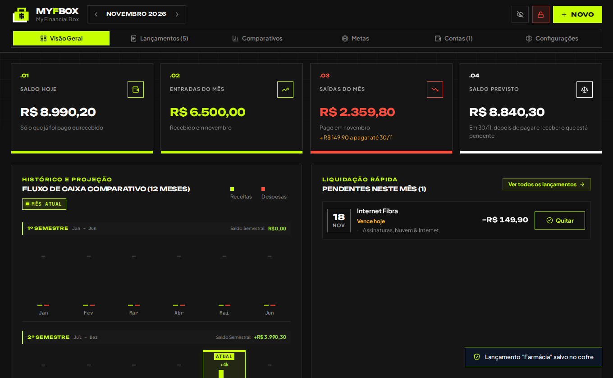
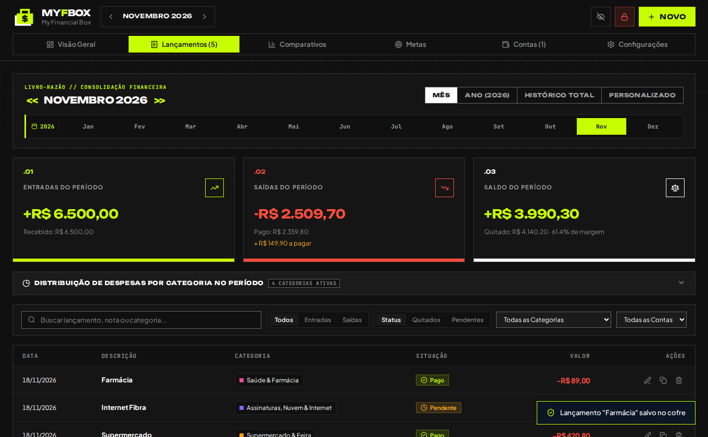
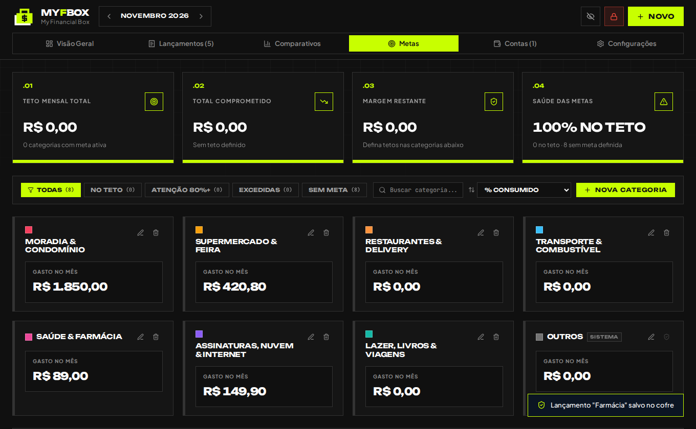

🇧🇷 [Português (Brasil)](README.md) · 🇬🇧 [English (UK)](README.en-GB.md) · 🇪🇸 [Español](README.es.md) · 🇨🇳 [简体中文](README.zh-CN.md)

# MyFBox

**Suas finanças pessoais sob o seu controle — 100% gratuito, código aberto e cifrado no seu dispositivo.**

[](https://github.com/thiegocarvalho/MyFBox/actions/workflows/ci.yml)
[](https://github.com/thiegocarvalho/MyFBox/actions/workflows/desktop-release.yml)
[](https://github.com/thiegocarvalho/MyFBox/actions/workflows/gh-pages.yml)
[](https://github.com/thiegocarvalho/MyFBox/releases)
[](LICENSE)
[](SECURITY.md)
[](#modo-mcp-local)

**[Abrir no Navegador](https://thiegocarvalho.github.io/MyFBox/app/)** · **[Baixar App Desktop (Win / Mac / Linux)](https://github.com/thiegocarvalho/MyFBox/releases)** · **[Site Oficial](https://thiegocarvalho.github.io/MyFBox/)**

Sem assinatura, sem criação de conta, sem servidor na nuvem e sem rastreio: todos os seus dados financeiros ficam salvos apenas no seu computador ou navegador, cifrados com **AES-256-GCM**. Só a sua senha mestra abre o cofre.

---

## Baixar ou usar agora

Escolha como prefere usar o MyFBox — ambos os formatos são **gratuitos**, funcionam offline e usam o mesmo formato de backup cifrado (`.myfbox.json`):

| Plataforma | Formato | Onde acessar |
|---|---|---|
| **Web (Navegador / PWA)** | Chrome, Edge, Firefox, Brave, Safari | **[Abrir no Navegador](https://thiegocarvalho.github.io/MyFBox/app/)** |
| **Windows** | Instalador `.exe` (NSIS) e versão portátil | **[GitHub Releases](https://github.com/thiegocarvalho/MyFBox/releases)** |
| **macOS** | Imagem `.dmg` (Apple Silicon `arm64` e Intel `x64`) | **[GitHub Releases](https://github.com/thiegocarvalho/MyFBox/releases)** |
| **Linux** | `AppImage` e pacote `.deb` | **[GitHub Releases](https://github.com/thiegocarvalho/MyFBox/releases)** |

> Os instaladores desktop são gerados automaticamente pelo workflow [Desktop Release](.github/workflows/desktop-release.yml) a cada nova tag publicada em [Releases](https://github.com/thiegocarvalho/MyFBox/releases) (veja também [thiegocarvalho.github.io/MyFBox/#baixar](https://thiegocarvalho.github.io/MyFBox/#baixar)).

---

## Por que usar o MyFBox?

| | Apps comuns na nuvem | **MyFBox** |
|---|---|---|
| **Preço** | Planos mensais ou recursos bloqueados | **100% gratuito e open-source (`AGPL-3.0`)** |
| **Conta e cadastro** | Exigem e-mail, senha e aceite de termos | **Zero cadastro — abra e use em segundos** |
| **Onde ficam seus dados** | Servidores de terceiros | **Só no seu dispositivo (AES-256-GCM)** |
| **Funciona sem internet** | Depende de servidor | **100% offline** |
| **Assistente de IA** | Seus extratos sobem para a nuvem | **MCP local em `127.0.0.1` só com cofre aberto** |

---

## Capturas de tela

| Visão Geral | Lançamentos | Metas |
|---|---|---|
|  |  |  |

---

## Converse com suas finanças (MCP Local)

O MyFBox permite conectar **Claude Desktop, Claude Code, Cursor, Antigravity** ou qualquer cliente compatível com **MCP (Model Context Protocol)** diretamente ao seu cofre aberto, sem enviar sua senha ou chave mestra para fora do computador:

> *"Registre R$ 84,50 no mercado hoje no Nubank"* · *"Quanto já gastei em mercado este mês?"* · *"Lembra que dia 25 vence a internet de R$ 149,90"*

- **Desligado por padrão:** você ativa nas Configurações quando quiser usar e autoriza o pareamento com conferência visual de código.
- **Trancou, cortou:** bloquear o app (manualmente ou por inatividade) encerra a conexão na hora.
- **Pronto no Desktop e na Web:** no **app Desktop** o servidor MCP já vem embutido; na **versão Web** basta copiar o prompt ou o `mcp.json` pronto em **Configurações → Assistente IA (MCP)** (executa via `npx` sem precisar clonar o repositório).
- **20 ferramentas prontas:** lançamentos, consultas, metas, contas, cotações offline, insights mensais e backup cifrado (veja [como configurar](#modo-mcp-local)).

---

## Recursos principais

- **Cofre cifrado (AES-256-GCM)**: contas, lançamentos, categorias, metas e insights ficam em um único cofre cifrado. A chave é derivada da sua senha mestra via `PBKDF2-HMAC-SHA256` (600.000 iterações) e nunca sai da memória.
- **Lançamentos completos**: parcelamento, recorrência mensal, status pago/pendente, categorização automática inteligente pela descrição e entrada ultrarrápida (atalho <kbd>N</kbd>).
- **Múltiplas moedas (100% offline)**: contas e lançamentos em 13 moedas globais (BRL, USD, EUR, GBP e mais), com cotações gerenciadas localmente sem consultar APIs externas.
- **Visão geral e previsão**: saldo de hoje (confirmado), entradas/saídas do mês, pendências em atraso e saldo previsto até o fim do mês.
- **Comparativos e insights**: acompanhe a evolução mês a mês com análises geradas sob demanda pelo seu assistente via MCP.
- **Metas mensais**: defina tetos de gasto por categoria e acompanhe o consumo em tempo real.
- **Backups portáteis e CSV**: exporte seu cofre cifrado (`.myfbox.json`) para guardar onde quiser ou gere planilhas CSV.

---

## Teclado e Produtividade

O MyFBox foi projetado para lançar despesas e receitas em segundos sem tirar as mãos do teclado:

### Atalhos Globais
| Atalho | Ação |
|---|---|
| <kbd>N</kbd> | Abre o modal para um **Novo Lançamento** (quando nenhum campo de texto estiver em foco) |

### No Modal de Lançamento
| Atalho | Ação |
|---|---|
| <kbd>Ctrl</kbd> + <kbd>Enter</kbd> ou <kbd>⌘</kbd> + <kbd>Enter</kbd> | **Registrar no Cofre** / Salvar alterações |
| <kbd>Ctrl</kbd> + <kbd>Shift</kbd> + <kbd>Enter</kbd> ou <kbd>Alt</kbd> + <kbd>N</kbd> | **Salvar e Novo** (grava o lançamento atual e abre espaço para o próximo sem fechar a janela) |
| <kbd>Alt</kbd> + <kbd>1</kbd> ou <kbd>Alt</kbd> + <kbd>D</kbd> ou <kbd>Ctrl</kbd> + <kbd>↓</kbd> | Alternar para **Despesa** (Débito) |
| <kbd>Alt</kbd> + <kbd>2</kbd> ou <kbd>Alt</kbd> + <kbd>R</kbd> ou <kbd>Ctrl</kbd> + <kbd>↑</kbd> | Alternar para **Receita** (Crédito) |
| <kbd>Esc</kbd> | Cancelar e fechar a janela |

### Fluxo de Lançamento Rápido
1. Pressione <kbd>N</kbd> em qualquer tela para abrir o lançamento com **foco imediato no valor**.
2. Digite o valor (ex: `150,50` ou `2400`) e aperte <kbd>Tab</kbd>.
3. Digite a descrição (ex: `Supermercado`); a **predição inteligente** seleciona a categoria automaticamente.
4. Pressione <kbd>Ctrl</kbd> + <kbd>Enter</kbd> para salvar ou <kbd>Ctrl</kbd> + <kbd>Shift</kbd> + <kbd>Enter</kbd> para já iniciar o próximo lançamento.

---

## Seus dados e backups

- Na versão **Web**, os dados existem apenas no navegador e endereço em uso (limpar dados do site ou trocar de navegador oculta o cofre local). No **Desktop**, o cofre fica salvo em `vault.myfbox.json` na pasta de dados do sistema (`app.getPath('userData')`).
- Exporte backups em **Configurações → Backups & Arquivos → Baixar backup cifrado**. O arquivo `.myfbox.json` já sai cifrado e pode ir para nuvem ou pen-drive; ele abre com a senha mestra que valia no momento do backup.
- **Não existe recuperação de senha.** Guarde sua senha mestra em um gerenciador de senhas.
- O app solicita **armazenamento persistente** ao navegador para evitar remoção automática por falta de espaço.

### Formato dos arquivos cifrados

O envelope usa `formatVersion: 1`, com parâmetros `PBKDF2-HMAC-SHA256` (600.000 iterações) e `AES-256-GCM` gravados no cabeçalho.

---

## Modo MCP local

Permite que assistentes de IA compatíveis com MCP leiam e registrem lançamentos **enquanto o cofre está aberto e desbloqueado**:

1. Abra o MyFBox (Desktop ou Web), destrave o cofre e vá em **Configurações → Assistente IA (MCP)**.
2. Ative o interruptor **Modo MCP local**.
3. Copie o **prompt pronto** (ou o `mcp.json`) exibido na tela e envie para o seu assistente de IA.
4. Abra o link de pareamento retornado pelo assistente, confira o código curto e clique em **Autorizar**.

Detalhes das ferramentas e fluxos de uso:
- [`.claude/skills/myfbox/SKILL.md`](.claude/skills/myfbox/SKILL.md): ferramentas e lançamentos
- [`.claude/skills/myfbox-insights/SKILL.md`](.claude/skills/myfbox-insights/SKILL.md): insights mensais

Variáveis opcionais do servidor: `MYFBOX_APP_URL` (padrão `http://localhost:41730`), `MYFBOX_MCP_PORT` (padrão `4777`), `MYFBOX_BACKUP_DIR` (padrão `vaults/`).

---

## Para desenvolvedores (rodar do código-fonte)

### Requisitos
- Node.js `^20.19` ou `>=22.12`
- Navegador moderno (Chrome, Edge, Firefox, Brave ou Safari)

### Instalação e execução local

```bash
git clone https://github.com/thiegocarvalho/MyFBox.git
cd MyFBox
npm install
npm run dev
```

Abra **http://localhost:41730**, crie um cofre e uma senha mestra.

> **A porta é fixa de propósito.** O cofre web fica no IndexedDB, separado por origem. Se abrir em outra porta, o cofre parece vazio (ele continua salvo na origem anterior). Por isso o Vite usa `strictPort`.

| Comando | O que faz |
|---|---|
| `npm run dev` | Servidor de desenvolvimento em `127.0.0.1:41730` |
| `npm run build` | Checagem de tipos + build de produção em `dist/` (com Content Security Policy) |
| `npm run preview` | Serve o build de produção na mesma porta |
| `npm run lint` | Lint com oxlint |
| `npm test` | Testes unitários (Vitest) |
| `npm run test:coverage` | Testes unitários com relatório de cobertura (v8) |
| `npm run test:e2e` | Testes ponta a ponta (Playwright) contra `vite preview` |
| `npm run mcp` | Inicia o servidor MCP local manualmente |
| `npm run electron:dev` | Abre o MyFBox no Electron em modo desenvolvimento |
| `npm run electron:start` | Compila app + Electron e abre a janela desktop |
| `npm run dist:linux` | Gera pacotes Linux (`AppImage` e `deb`) em `release/` |
| `npm run dist:win` | Gera instalador Windows (`nsis` e `portable`) |
| `npm run dist:mac` | Gera imagem macOS (`dmg` `x64` e `arm64`) |

### Estrutura

```text
src/
  App.tsx                     dono do estado; toda gravação passa por persistVaultUpdate
  domain/                     casos de uso puros do cofre, validação de esquema e IDs criptográficos
  components/                 telas (Visão Geral, Lançamentos, Comparativos, Metas, Contas, Configurações)
  services/cryptoVault.ts     cifra/decifra o cofre com WebCrypto (AES-256-GCM + PBKDF2)
  services/vaultStorage.ts    adapter de persistência (IPC desktop ou IndexedDB no navegador)
  services/currencyService.ts catálogo e conversão offline de 13 moedas
  services/mcpBridge.ts       ponte do navegador com o servidor MCP local
  services/mcpActions.ts      ações do MCP (20 ferramentas puras)
  utils/                      cálculos, formatação, categorização e config MCP
electron/                     shell desktop seguro (`main.ts`, `preload.ts`, `vaultStore.ts`, `menu.ts`)
landing/                      landing page estática para a raiz do GitHub Pages (excluída do Electron)
e2e/                          testes ponta a ponta com Playwright
mcp/server.mjs                servidor MCP (stdio) + ponte WebSocket/HTTP autenticada em 127.0.0.1
```

## Segurança e Contribuição

- Segurança e modelo de ameaças: [SECURITY.md](SECURITY.md)
- Como contribuir: [CONTRIBUTING.md](CONTRIBUTING.md), [CODE_OF_CONDUCT.md](CODE_OF_CONDUCT.md) e [CLAUDE.md](CLAUDE.md)

## Licença

Copyright (C) 2026 Zeru.

Este programa é software livre: você pode redistribuí-lo e/ou modificá-lo nos termos da **GNU Affero General Public License**, versão 3 ou (a seu critério) qualquer versão posterior, publicada pela Free Software Foundation. Veja o arquivo [LICENSE](LICENSE).

Em resumo: você pode usar, estudar, modificar e distribuir o MyFBox. Se distribuir uma versão modificada **ou oferecê-la para outras pessoas usarem pela rede** (por exemplo, hospedando o app), precisa disponibilizar o código-fonte dessa versão sob a mesma licença.
