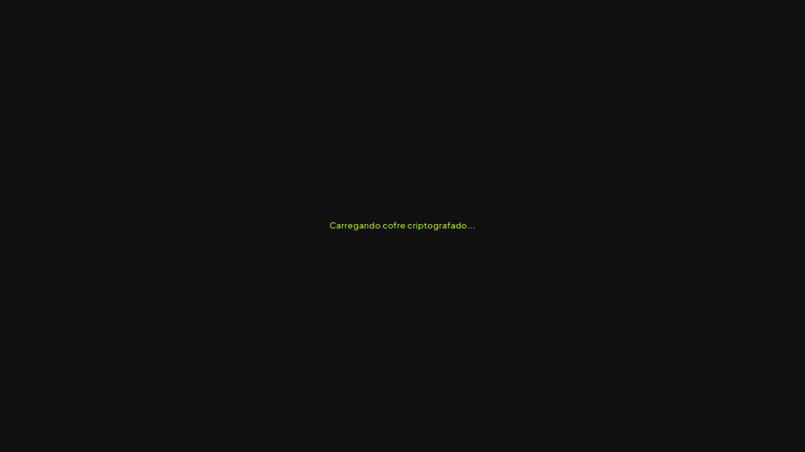
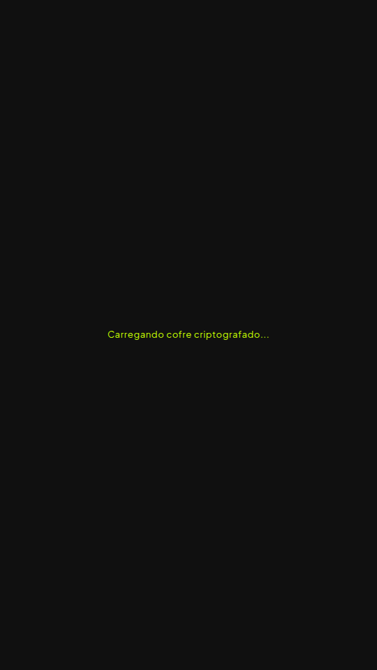

# MyFBox

[](https://github.com/thiegocarvalho/MyFBox/actions/workflows/ci.yml)
[](https://github.com/thiegocarvalho/MyFBox/actions/workflows/desktop-release.yml)
[](https://github.com/thiegocarvalho/MyFBox/actions/workflows/gh-pages.yml)
[](https://github.com/thiegocarvalho/MyFBox/releases)
[](LICENSE)
[](SECURITY.md)

Controle financeiro pessoal **local-first** e **cifrado no seu dispositivo**. Sem conta, sem
servidor, sem rastreio: os dados ficam no seu navegador (ou arquivo local no app desktop), cifrados com AES-256-GCM, e só a sua
senha mestra abre o cofre.

> Interface em português do Brasil · React 19 + TypeScript + Vite + Electron · estilo neo-brutalista

## Capturas de tela

| Desktop | Mobile |
|---|---|
|  |  |

## Recursos

- **Cofre cifrado**: todo o estado (contas, lançamentos, categorias, metas, insights) é um único
  JSON cifrado com AES-256-GCM. A chave é derivada da senha por PBKDF2-HMAC-SHA256
  (600.000 iterações) e nunca sai da memória do navegador.
- **Lançamentos** com parcelamento/recorrência mensal, situação paga/pendente, categorização
  automática pela descrição e entrada rápida (atalho <kbd>N</kbd>).
- **Múltiplas moedas (100% offline)**: lançamentos e contas em reais, dólares ou outras moedas,
  com cotações locais gerenciadas manualmente no painel ou pelo assistente via MCP (sem nenhuma consulta a APIs externas).
- **Visão geral** com saldo de hoje (só o confirmado), entradas/saídas do mês, pendências em
  atraso e saldo previsto até o fim do mês.
- **Comparativos** mês a mês, com **insights** escritos por um assistente (via MCP) e aviso
  quando os números do mês mudam depois do insight.
- **Metas** (teto mensal) por categoria de despesa.
- **Backups** cifrados (`.myfbox.json`), restauração e exportação de planilha CSV.
- **Modo MCP local** (opcional, desligado por padrão): assistentes ou agentes de IA locais consultam
  e registram lançamentos no cofre aberto, só pela sua máquina.

## Teclado e Produtividade

O MyFBox foi projetado com filosofia neo-brutalista de alta velocidade: lance despesas e receitas rapidamente sem precisar tirar as mãos do teclado.

### Atalhos Globais
| Atalho | Ação |
|---|---|
| <kbd>N</kbd> | Abre o modal para um **Novo Lançamento** (quando nenhum campo de texto estiver em foco) |

### No Modal de Lançamento
| Atalho | Ação |
|---|---|
| <kbd>Ctrl</kbd> + <kbd>Enter</kbd> ou <kbd>⌘</kbd> + <kbd>Enter</kbd> | **Registrar no Cofre** / Salvar alterações |
| <kbd>Ctrl</kbd> + <kbd>Shift</kbd> + <kbd>Enter</kbd> ou <kbd>Alt</kbd> + <kbd>N</kbd> | **Salvar e Novo** (grava o lançamento atual e abre espaço para o próximo sem fechar a janela) |
| <kbd>Alt</kbd> + <kbd>1</kbd> ou <kbd>Alt</kbd> + <kbd>D</kbd> ou <kbd>Ctrl</kbd> + <kbd>↓</kbd> | Alternar para **Despesa** (Débito) |
| <kbd>Alt</kbd> + <kbd>2</kbd> ou <kbd>Alt</kbd> + <kbd>R</kbd> ou <kbd>Ctrl</kbd> + <kbd>↑</kbd> | Alternar para **Receita** (Crédito) |
| <kbd>Esc</kbd> | Cancelar e fechar a janela |

### Fluxo de Lançamento Rápido
1. Pressione <kbd>N</kbd> em qualquer tela para abrir o lançamento com **foco imediato no valor**.
2. Digite o valor monetário (ex: `150,50` ou `2400`) e aperte <kbd>Tab</kbd>.
3. Digite a descrição (ex: `Supermercado`); a **predição inteligente** já seleciona a categoria certa com base no seu histórico.
4. Pressione <kbd>Ctrl</kbd> + <kbd>Enter</kbd> para registrar imediatamente no cofre cifrado, ou <kbd>Ctrl</kbd> + <kbd>Shift</kbd> + <kbd>Enter</kbd> para já iniciar o próximo lançamento.

## Requisitos

- Node.js `^20.19` ou `>=22.12`
- Um navegador moderno (Chrome, Edge, Firefox ou Safari recentes)

## Começando

```bash
npm install
npm run dev
```

Abra **http://localhost:41730**, crie um cofre e uma senha mestra.

> **A porta é fixa de propósito.** O cofre fica no IndexedDB, que é separado por endereço
> (origem). Se o app abrir em outra porta, o cofre parece sumir (ele continua salvo no endereço
> antigo). Por isso o Vite usa `strictPort` e falha em vez de trocar de porta.

| Comando | O que faz |
|---|---|
| `npm run dev` | Servidor de desenvolvimento em `127.0.0.1:41730` |
| `npm run build` | Checagem de tipos + build de produção em `dist/` (com Content Security Policy) |
| `npm run preview` | Serve o build de produção na mesma porta |
| `npm run lint` | Lint com oxlint |
| `npm test` | Testes unitários (Vitest) |
| `npm run test:coverage` | Testes unitários com relatório de cobertura (v8) |
| `npm run test:e2e` | Testes ponta a ponta (Playwright) contra `vite preview` |
| `npm run mcp` | Inicia o servidor MCP local manualmente (normalmente o cliente MCP inicia sozinho) |
| `npm run electron:dev` | Abre o MyFBox no Electron em modo desenvolvimento |
| `npm run electron:start` | Compila app + Electron e abre a janela desktop |
| `npm run dist:linux` | Gera pacotes Linux (`AppImage` e `deb`) em `release/` |
| `npm run dist:win` | Gera instalador Windows (`nsis` e `portable`) |
| `npm run dist:mac` | Gera imagem macOS (`dmg` `x64` e `arm64`) |

> **Versão Desktop vs Web (GitHub Pages):** o app web e o Electron compartilham o mesmo build Vite (`base: './'`). No GitHub Pages, a Landing Page (`landing/`) fica na raiz (`/`) e o app web em `/app/`, enquanto o pacote Electron nunca inclui `landing/`. No desktop, o cofre cifrado é gravado em `vault.myfbox.json` no diretório de dados do usuário (`app.getPath('userData')`).

## Seus dados e backups

- Os dados existem **só neste navegador, neste endereço**. Limpar os dados do site, trocar de
  navegador/perfil/computador ou mudar a porta "esconde" o cofre.
- Faça backup em **Backups › Baixar backup cifrado**. O arquivo `.myfbox.json` é cifrado: pode
  ir para a nuvem ou um pen-drive. Ele abre com a **senha mestra que valia no momento do
  backup**, em **Restaurar** (tela de login ou aba Backups).
- **Não existe recuperação de senha.** Guarde a senha mestra num gerenciador de senhas.
- O app pede ao navegador **armazenamento persistente** para que o cofre não seja apagado quando
  faltar espaço. Favoritar o app ajuda o Chrome a conceder.
- As pastas `vaults/` e `backups/` e qualquer `*.myfbox.json` são ignoradas pelo git.

### Compatibilidade dos arquivos cifrados

O formato do envelope é `formatVersion: 1` e o número de iterações do PBKDF2 fica gravado nele.
Cofres e backups antigos (310.000 iterações) continuam abrindo e são recifrados com o padrão
atual (600.000) no próximo desbloqueio ou restauração. Arquivos novos também abrem em versões
anteriores do app.

## Modo MCP local

Permite que qualquer assistente de IA compatível com MCP leia e altere o cofre **enquanto
ele está aberto e desbloqueado**, sem que a senha ou a chave saiam do navegador.

1. Rode o app (`npm run dev`) e desbloqueie o cofre.
2. Abra seu assistente de IA na pasta do projeto: o `.mcp.json` registra o servidor `myfbox`.
3. Peça "conecte ao MyFBox". O assistente mostra um **link de pareamento** e um **código curto**.
4. Abra o link, confira o código e clique em **Autorizar**.

Depois é só pedir: "registre um almoço de R$ 42 hoje", "quanto gastei em mercado este mês?",
"gere o insight de novembro", "faz um backup". Trancar o app (manual ou por inatividade) corta o
acesso na hora. Detalhes das ferramentas e receitas de uso:

- [`.claude/skills/myfbox/SKILL.md`](.claude/skills/myfbox/SKILL.md): ferramentas e lançamentos
- [`.claude/skills/myfbox-insights/SKILL.md`](.claude/skills/myfbox-insights/SKILL.md): insights mensais

Variáveis opcionais do servidor: `MYFBOX_APP_URL` (padrão `http://localhost:41730`),
`MYFBOX_MCP_PORT` (padrão `4777`), `MYFBOX_BACKUP_DIR` (padrão `vaults/`).

## Segurança

Veja [SECURITY.md](SECURITY.md) para o modelo de ameaças, os detalhes criptográficos e como
reportar vulnerabilidades.

## Estrutura

```
src/
  App.tsx                   dono do estado; toda gravação passa por persistVaultUpdate
  domain/                   casos de uso puros do cofre, validação de esquema e IDs criptográficos
  components/               telas (Visão Geral, Lançamentos, Comparativos, Metas, Contas, Backups)
  services/cryptoVault.ts   cifra/decifra o cofre com WebCrypto (AES-256-GCM + PBKDF2)
  services/vaultStorage.ts  adapter de persistência do cofre (IPC desktop ou IndexedDB no navegador)
  services/currencyService.ts helpers e catálogo de moedas (re-exporta regras puras de `domain/currency.ts`)
  services/mcpBridge.ts     ponte do navegador com o servidor MCP local
  services/mcpActions.ts    ações do MCP (20 ferramentas puras)
  utils/                    cálculos de saldo, conversão, comparativos, formatação
electron/                   shell desktop seguro (`main.ts`, `preload.ts`, `vaultStore.ts`, `menu.ts`)
landing/                    landing page estática para a raiz do GitHub Pages (excluída do Electron)
e2e/                        testes ponta a ponta com Playwright
mcp/server.mjs              servidor MCP (stdio) + ponte WebSocket/HTTP autenticada em 127.0.0.1
```

Mais detalhes de arquitetura para quem vai contribuir estão em [CLAUDE.md](CLAUDE.md).

## Licença

Copyright (C) 2026 Zeru.

Este programa é software livre: você pode redistribuí-lo e/ou modificá-lo nos termos da
**GNU Affero General Public License**, versão 3 ou (a seu critério) qualquer versão posterior,
publicada pela Free Software Foundation. Veja o arquivo [LICENSE](LICENSE).

Em resumo: você pode usar, estudar, modificar e distribuir o MyFBox. Se distribuir uma versão
modificada **ou oferecê-la para outras pessoas usarem pela rede** (por exemplo, hospedando o app),
precisa disponibilizar o código-fonte dessa versão sob a mesma licença.
