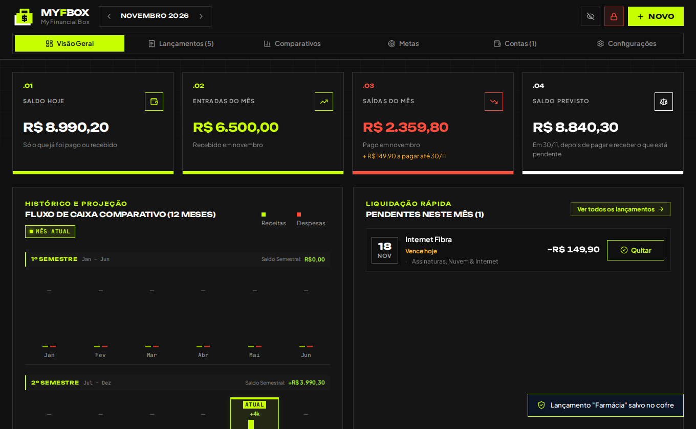
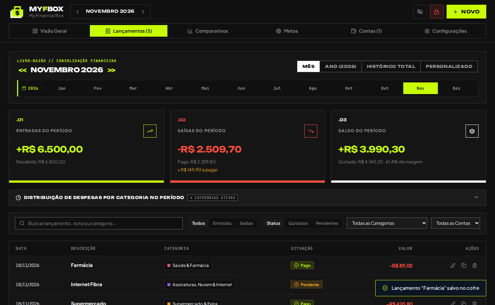
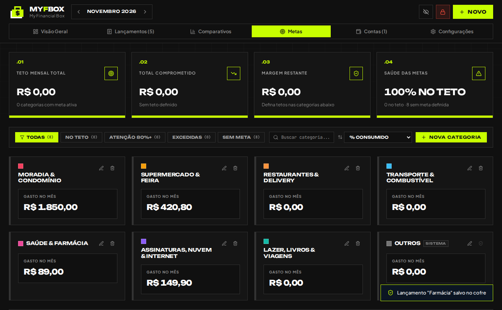

🇧🇷 [Português (Brasil)](README.md) · 🇬🇧 [English (UK)](README.en-GB.md) · 🇪🇸 [Español](README.es.md) · 🇨🇳 [简体中文](README.zh-CN.md)

# MyFBox

**掌控您的个人财务 — 100% 免费、开源，并在您的设备上加密存储。**

[](https://github.com/thiegocarvalho/MyFBox/actions/workflows/ci.yml)
[](https://github.com/thiegocarvalho/MyFBox/actions/workflows/desktop-release.yml)
[](https://github.com/thiegocarvalho/MyFBox/actions/workflows/gh-pages.yml)
[](https://github.com/thiegocarvalho/MyFBox/releases)
[](LICENSE)
[](docs/i18n/SECURITY.zh-CN.md)
[](#本地-mcp-模式)

**[在浏览器中打开](https://thiegocarvalho.github.io/MyFBox/app/)** · **[下载桌面应用 (Win / Mac / Linux)](https://github.com/thiegocarvalho/MyFBox/releases)** · **[官方网站](https://thiegocarvalho.github.io/MyFBox/)**

无需订阅、无需注册账号、无云服务器、无任何追踪：您的所有财务数据仅保存在您的电脑或浏览器中，并使用 **AES-256-GCM** 加密。只有您的主密码才能解锁保险库。

---

## 立即下载或使用

选择您喜欢的使用方式 — 两种形态均**免费**、支持离线运行，并使用相同的加密备份格式（`.myfbox.json`）：

| 平台 | 格式 | 获取方式 |
|---|---|---|
| **Web（浏览器 / PWA）** | Chrome、Edge、Firefox、Brave、Safari | **[在浏览器中打开](https://thiegocarvalho.github.io/MyFBox/app/)** |
| **Windows** | `.exe` 安装程序（NSIS）及便携版 | **[GitHub Releases](https://github.com/thiegocarvalho/MyFBox/releases)** |
| **macOS** | `.dmg` 镜像（Apple Silicon `arm64` 与 Intel `x64`） | **[GitHub Releases](https://github.com/thiegocarvalho/MyFBox/releases)** |
| **Linux** | `AppImage` 与 `.deb` 安装包 | **[GitHub Releases](https://github.com/thiegocarvalho/MyFBox/releases)** |

> 桌面端安装包会在每次于 [Releases](https://github.com/thiegocarvalho/MyFBox/releases) 发布新标签时，由 [Desktop Release](.github/workflows/desktop-release.yml) 工作流自动构建（另见 [thiegocarvalho.github.io/MyFBox/#baixar](https://thiegocarvalho.github.io/MyFBox/#baixar)）。

---

## 为什么选择 MyFBox？

| | 常见云端记账应用 | **MyFBox** |
|---|---|---|
| **价格** | 按月订阅或付费解锁功能 | **100% 免费且开源（`AGPL-3.0`）** |
| **账号与注册** | 需邮箱、密码并同意服务条款 | **零注册 — 打开即用** |
| **数据存放位置** | 第三方服务器 | **仅在您的设备上（AES-256-GCM）** |
| **无网络时使用** | 依赖服务器 | **100% 离线可用** |
| **AI 助手** | 账单明细上传至云端 | **仅在保险库解锁时通过 `127.0.0.1` 运行本地 MCP** |

---

## 界面截图

| 总览 | 收支明细 | 预算目标 |
|---|---|---|
|  |  |  |

---

## 与您的财务对话（本地 MCP）

MyFBox 支持将 **Claude Desktop、Claude Code、Cursor、Antigravity** 或任何兼容 **MCP (Model Context Protocol)** 的客户端直接连接到已解锁的保险库，绝不将您的密码或主密钥发送到计算机之外：

> *“今天在超市消费 84.50”* · *“这个月超市已经花了多少？”* · *“记住 25 号要交 149.90 的宽带费”*

- **默认关闭：** 您可以在“设置”中按需开启，并通过可视化验证码核对来授权配对。
- **锁定即断开：** 锁定应用（手动或因闲置自动锁定）会立即终止连接。
- **桌面端与网页端均可使用：** **桌面应用**已内置 MCP 服务器；在 **Web 版**中只需前往 **设置 → AI 助手 (MCP)** 复制现成的提示词或 `mcp.json`（通过 `npx` 运行，无需克隆仓库）。
- **20 个内置工具：** 记账、查询、预算、账户、离线汇率、月度洞察及加密备份（详见[如何配置](#本地-mcp-模式)）。

---

## 核心功能

- **加密保险库 (AES-256-GCM)**：账户、交易记录、分类、预算目标与洞察报告均保存在单一加密保险库中。密钥通过 `PBKDF2-HMAC-SHA256`（600,000 次迭代）从主密码派生，且永不离开内存。
- **完整的交易管理**：分期付款、按月循环、已付/待付状态、基于描述的智能自动分类以及极速录入（快捷键 <kbd>N</kbd>）。
- **多币种支持（100% 离线）**：支持 13 种全球货币（BRL、USD、EUR、GBP 等）的账户与交易，汇率在本地管理，无需请求外部 API。
- **总览与预测**：今日（已确认）余额、本月收支、逾期未结项以及截至月底的预计余额。
- **对比与洞察**：按月追踪财务变化，并由您的助手通过 MCP 按需生成分析洞察。
- **月度预算目标**：按分类设置支出上限，实时追踪消费进度。
- **便携备份与 CSV**：导出加密保险库文件（`.myfbox.json`）以便随处存放，或生成 CSV 电子表格。

---

## 键盘操作与效率

MyFBox 专为键盘高效录入而设计，无需离开键盘即可在几秒内完成记账：

### 全局快捷键
| 快捷键 | 操作 |
|---|---|
| <kbd>N</kbd> | 打开**新建交易**弹窗（当没有文本输入框处于焦点时） |

### 交易弹窗内快捷键
| 快捷键 | 操作 |
|---|---|
| <kbd>Ctrl</kbd> + <kbd>Enter</kbd> 或 <kbd>⌘</kbd> + <kbd>Enter</kbd> | **保存到保险库** / 保存修改 |
| <kbd>Ctrl</kbd> + <kbd>Shift</kbd> + <kbd>Enter</kbd> 或 <kbd>Alt</kbd> + <kbd>N</kbd> | **保存并新建**（保存当前记录并直接准备下一条，不关闭窗口） |
| <kbd>Alt</kbd> + <kbd>1</kbd> 或 <kbd>Alt</kbd> + <kbd>D</kbd> 或 <kbd>Ctrl</kbd> + <kbd>↓</kbd> | 切换为**支出**（借记） |
| <kbd>Alt</kbd> + <kbd>2</kbd> 或 <kbd>Alt</kbd> + <kbd>R</kbd> 或 <kbd>Ctrl</kbd> + <kbd>↑</kbd> | 切换为**收入**（贷记） |
| <kbd>Esc</kbd> | 取消并关闭窗口 |

### 快速记账流程
1. 在任意界面按 <kbd>N</kbd> 打开记账窗口，光标将**立即聚焦于金额栏**。
2. 输入金额（例如 `150.50` 或 `2400`）并按 <kbd>Tab</kbd>。
3. 输入描述（例如 `超市`）；**智能预测**会自动为您选择分类。
4. 按 <kbd>Ctrl</kbd> + <kbd>Enter</kbd> 保存，或按 <kbd>Ctrl</kbd> + <kbd>Shift</kbd> + <kbd>Enter</kbd> 立即开始下一笔记录。

---

## 您的数据与备份

- 在 **Web** 版中，数据仅存在于当前使用的浏览器和源（origin）中（清除网站数据或更换浏览器将无法看到本地保险库）。在 **Desktop** 版中，保险库保存在系统数据目录（`app.getPath('userData')`）下的 `vault.myfbox.json`。
- 可在 **设置 → 备份与文件 → 下载加密备份** 中导出备份。`.myfbox.json` 文件本身已完成加密，可放心存入云盘或 U 盘；打开时需使用备份当时生效的主密码。
- **没有密码找回功能。** 请务必将您的主密码保存在密码管理器中。
- 应用会向浏览器请求**持久化存储**权限，以防因磁盘空间不足而被自动清理。

### 加密文件格式

加密信封使用 `formatVersion: 1`，并在文件头中记录 `PBKDF2-HMAC-SHA256`（600,000 次迭代）和 `AES-256-GCM` 参数。

---

## 本地 MCP 模式

允许兼容 MCP 的 AI 助手**在保险库处于打开且已解锁状态时**读取和记录交易：

1. 打开 MyFBox（桌面版或网页版），解锁保险库并前往 **设置 → AI 助手 (MCP)**。
2. 开启 **本地 MCP 模式** 开关。
3. 复制屏幕上显示的**现成提示词**（或 `mcp.json`）并发送给您的 AI 助手。
4. 打开助手返回的配对链接，核对短验证码并点击 **授权**。

工具详情与使用工作流：
- [`.claude/skills/myfbox/SKILL.md`](.claude/skills/myfbox/SKILL.md)：工具与交易操作
- [`.claude/skills/myfbox-insights/SKILL.md`](.claude/skills/myfbox-insights/SKILL.md)：月度洞察

可选服务器环境变量：`MYFBOX_APP_URL`（默认 `http://localhost:41730`）、`MYFBOX_MCP_PORT`（默认 `4777`）、`MYFBOX_BACKUP_DIR`（默认 `vaults/`）。

---

## 开发者指南（从源码运行）

### 环境要求
- Node.js `^20.19` 或 `>=22.12`
- 现代浏览器（Chrome、Edge、Firefox、Brave 或 Safari）

### 安装与本地运行

```bash
git clone https://github.com/thiegocarvalho/MyFBox.git
cd MyFBox
npm install
npm run dev
```

打开 **http://localhost:41730**，创建一个保险库并设置主密码。

> **端口是特意固定的。** Web 保险库存储在 IndexedDB 中，按源（origin）隔离。如果使用其他端口打开，保险库会显示为空（它仍然保存在之前的源中）。因此 Vite 配置了 `strictPort`。

| 命令 | 说明 |
|---|---|
| `npm run dev` | 在 `127.0.0.1:41730` 启动开发服务器 |
| `npm run build` | 类型检查 + 在 `dist/` 生成生产构建（含 Content Security Policy） |
| `npm run preview` | 在同一端口提供生产构建预览 |
| `npm run lint` | 使用 oxlint 进行代码检查 |
| `npm test` | 单元测试（Vitest） |
| `npm run test:coverage` | 带覆盖率报告的单元测试（v8） |
| `npm run test:e2e` | 针对 `vite preview` 的端到端测试（Playwright） |
| `npm run mcp` | 手动启动本地 MCP 服务器 |
| `npm run electron:dev` | 以开发模式在 Electron 中打开 MyFBox |
| `npm run electron:start` | 编译应用 + Electron 并打开桌面窗口 |
| `npm run dist:linux` | 在 `release/` 生成 Linux 安装包（`AppImage` 和 `deb`） |
| `npm run dist:win` | 生成 Windows 安装程序（`nsis` 和 `portable`） |
| `npm run dist:mac` | 生成 macOS 镜像（`dmg` `x64` 和 `arm64`） |

### 目录结构

```text
src/
  App.tsx                     状态所有者；所有写入均经过 persistVaultUpdate
  domain/                     纯保险库用例、模式校验与加密 ID
  components/                 页面视图（总览、明细、对比、预算、账户、设置）
  services/cryptoVault.ts     使用 WebCrypto（AES-256-GCM + PBKDF2）加解密保险库
  services/vaultStorage.ts    持久化适配器（桌面端 IPC 或浏览器 IndexedDB）
  services/currencyService.ts 13 种货币的离线目录与换算
  services/mcpBridge.ts       浏览器与本地 MCP 服务器的桥接
  services/mcpActions.ts      MCP 动作（20 个纯工具）
  utils/                      计算、格式化、自动分类与 MCP 配置
electron/                     安全桌面外壳（`main.ts`、`preload.ts`、`vaultStore.ts`、`menu.ts`）
landing/                      用于 GitHub Pages 根目录的静态落地页（不包含在 Electron 中）
e2e/                          Playwright 端到端测试
mcp/server.mjs                MCP 服务器（stdio）+ 位于 127.0.0.1 的认证 WebSocket/HTTP 桥接
```

## 安全与贡献

- 安全与威胁模型：[SECURITY.zh-CN.md](docs/i18n/SECURITY.zh-CN.md)
- 如何贡献：[CONTRIBUTING.zh-CN.md](docs/i18n/CONTRIBUTING.zh-CN.md)、[CODE_OF_CONDUCT.zh-CN.md](docs/i18n/CODE_OF_CONDUCT.zh-CN.md) 与 [CLAUDE.md](CLAUDE.md)

## 许可证

Copyright (C) 2026 Zeru.

本程序是自由软件：您可以根据自由软件基金会发布的 **GNU Affero General Public License** 第 3 版或（由您选择）任何更高版本的条款重新分发和/或修改它。请参阅 [LICENSE](LICENSE) 文件。

简而言之：您可以自由使用、研究、修改和分发 MyFBox。如果您分发修改后的版本**或通过网络向他人提供使用**（例如自行托管该应用），您必须以相同的许可证公开该版本的源代码。
